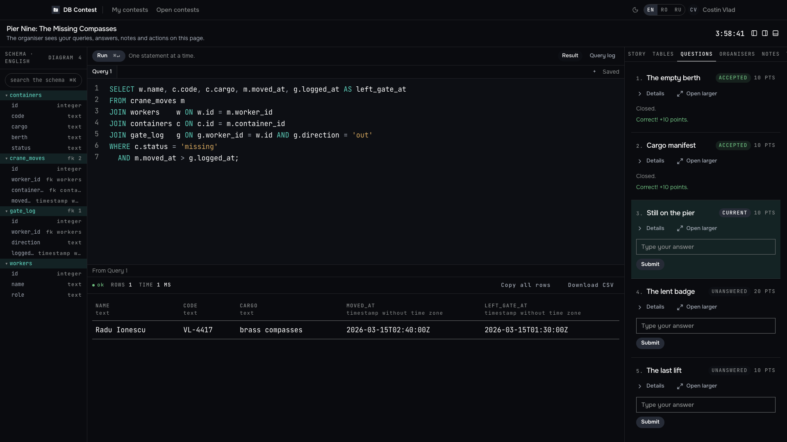
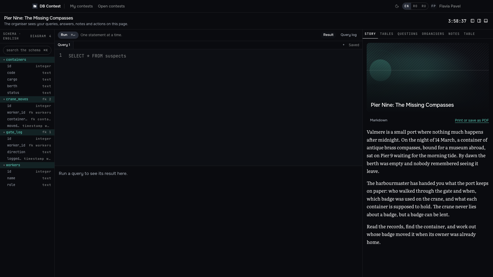
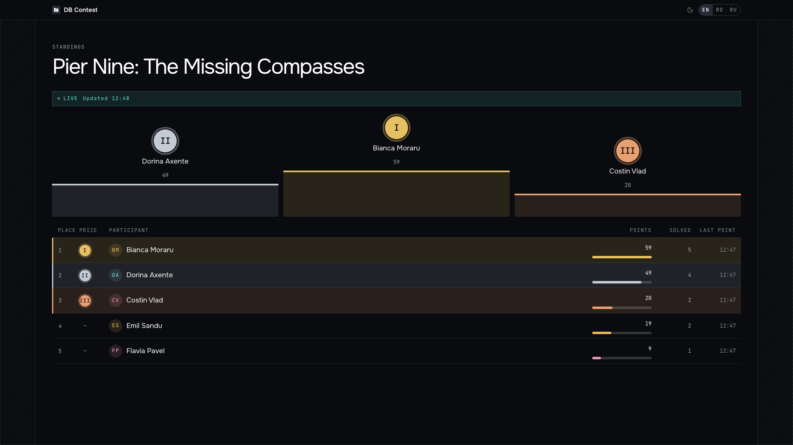

<div align="center">


# OlympDB Platform

**A platform for SQL olympiads in a detective format: read the story, query the evidence database, name the culprit.**

[](https://github.com/devrdn/olymp-db-platform/actions/workflows/backend.yml)
[](https://github.com/devrdn/olymp-db-platform/actions/workflows/frontend.yml)
[](https://github.com/devrdn/olymp-db-platform/releases)
[](LICENSE)

[Quick start](#quick-start) · [Documentation](#documentation) · [Troubleshooting](docs/guide/08-troubleshooting.md) · [Contributing](#contributing-and-security)

</div>

<p align="center">
  
</p>

## What it is

Students are given the story of a crime and a database that holds the evidence.
They write SQL in a browser console, answer questions from what the queries
tell them, and name the culprit. The database is the puzzle: every question is
answerable only by querying the game database that came with the story.

Every participant works in their own copy of that database, so nothing one of
them does can be seen by another. Every query is parsed by PostgreSQL's own
parser, checked against the contest's policy, and run under a statement
timeout, a result-size budget and a disk quota.

People sign in with a password, an emailed code, Microsoft, Google or GitHub,
wherever the installation turns them on. The interface is in English, Romanian
and Russian.

**Participants** get:

- a contest page with the story, the clock and the questions;
- a SQL console with highlighting, tabs, query history and a result table that opens a row;
- notes that stay where they were left, and answers checked the moment they are submitted, with the attempts and penalties the organiser set;
- a profile with their contests, reports and history.

**Organisers** get:

- a contest builder: the story in Markdown, questions with reference answers, and the game database as a SQL script, a finished dump, or a table-by-table builder that takes CSV files;
- staff and roles, and a per-contest SQL policy for what participants may run;
- open or invitation-only registration, optionally limited to an address range;
- live monitoring with a filterable query feed, per-participant queries, CSV export, and a leaderboard with an optional freeze.

**Administrators** get:

- self-signup, sign-in providers and their switches, and a forgotten-password reset by emailed link, all controlled per installation;
- an audit trail, backups and restore, and Prometheus, Loki and Grafana as an optional add-on.

<table>
  <tr>
    <td width="50%"><br><sub>The contest page: the story, the clock and the schema.</sub></td>
    <td width="50%"><br><sub>The standings: a podium and the ranked table.</sub></td>
  </tr>
</table>

## Quick start

For development. You need Go (the version in [backend/go.mod](backend/go.mod)),
Node 22, Docker with Compose v2, `make` and a C compiler (the Query Runner
links PostgreSQL's parser through cgo).

```bash
# 1. Configuration: readable by you alone (make refuses it otherwise).
install -m 600 deploy/.env.example deploy/.env
```

Edit `deploy/.env` and replace every `change-me` value with a secret from
`openssl rand -hex 32`. Use hex, not base64: base64 characters break the
database URLs.

```bash
# 2. Infrastructure: both PostgreSQL clusters and Redis.
make dev-up

# 3. Schema, the game cluster's roles, and the first administrator
#    (the password is printed once).
make migrate-up
make game-roles
make bootstrap

# 4. Three processes, each in its own terminal.
make runner   # the Query Runner: without it there is no console
make run      # the Core API on :8080
make front    # the interface on http://localhost:3000
```

Sign in as `admin` with the printed password. `make help` lists every target.

To run the stack as a deployment does (Caddy, API, Query Runner, interface and
databases in containers), use `make stack-up` and then `make stack-bootstrap`;
the production procedure is in [backend/README.md](backend/README.md) and under
[deploy/](deploy/).

Something not working? See the [troubleshooting guide](docs/guide/08-troubleshooting.md).

## Documentation

| Document | What it covers |
| --- | --- |
| [docs/README.md](docs/README.md) | The index of every document |
| [docs/ARCHITECTURE.md](docs/ARCHITECTURE.md) | The design, the trade-offs, and what is and is not finished |
| [Developer guide](docs/guide/01-overview.md) | Chapters 01 to 08: [overview](docs/guide/01-overview.md), [use cases](docs/guide/02-use-cases.md), [flows](docs/guide/03-flows.md), [backend](docs/guide/04-backend.md), [frontend](docs/guide/05-frontend.md), [testing](docs/guide/06-testing.md), [running a contest](docs/guide/07-running-a-contest.md), [troubleshooting](docs/guide/08-troubleshooting.md) |
| [backend/README.md](backend/README.md) | The Core API: configuration, endpoints, sign-in, deployment, backups |
| [frontend/README.md](frontend/README.md) | The interface |
| [CONTRIBUTING.md](CONTRIBUTING.md) | How changes are made |
| [SECURITY.md](SECURITY.md) | Reporting a vulnerability |

## How it is put together

```
        browser
           |
         Caddy  -- TLS, the only port open to the outside
           |
    +------+-------+
    |              |
 Next.js        Core API ------- PostgreSQL (core)
 (interface)    (Go monolith)     accounts, contests, questions,
                    |             submissions, audit, query log
                    | gRPC
              Query Runner ------ PostgreSQL (game cluster)
              (Go + cgo)          one database per participant,
                                  copied from the contest's template
```

The Query Runner is a separate process on purpose. It is the only component
that runs SQL a stranger wrote, and it links PostgreSQL's real parser through
cgo: C code reading adversarial text, where a crash ends the process. Kept
out of the API, such a crash cannot take down sign-in, the clock or answer
submission. It also holds the participants' database roles; the Core API
reaches the game cluster only as the provisioning role. See
[docs/ARCHITECTURE.md](docs/ARCHITECTURE.md).

## Testing

```bash
make check            # format, vet and unit tests: run before pushing
make test-db          # repository tests, on a database recreated from zero
make test-game        # the game cluster's isolation, as the participant's role
make test-game-build  # the path that crosses both clusters
make front-check      # the interface's lint, checks, tests and build
make test-all         # the backend gate CI runs, without database tests
```

Tests that need a database skip rather than pass quietly. CI runs them, so run
the three database targets before trusting a green `test-all`. See the
[testing chapter](docs/guide/06-testing.md).

## Layout

```
backend/    cmd/ (api, queryrunner, migrate, ...), internal/, migrations/, proto/
frontend/   Next.js App Router, three locales
deploy/     Docker Compose, Caddy, backups, observability
docs/       architecture, guide, design system, API contracts
```

## Status

The platform runs contests. Section 15 of the architecture document lists what
is finished and what is not.

## Built with AI assistance

OlympDB Platform is designed, written and maintained by its author. Claude (Anthropic), working through Claude Code, assists with the work: drafting designs and plans, writing and reviewing code and tests, security reviews and documentation. Every change is reviewed and merged by the author.

## Contributing and security

How changes are made here (English in everything committed, a linear history,
tests on the path the deployment uses) is in [CONTRIBUTING.md](CONTRIBUTING.md).
Report a vulnerability privately, not in an issue: see [SECURITY.md](SECURITY.md).

## License

Copyright 2026 Nartea Nichita.

OlympDB Platform is licensed under the [Apache License, Version 2.0](LICENSE). You
may use, modify and run it, including for commercial purposes, provided you
keep the license and the [NOTICE](NOTICE) with it and say what you changed.
The fonts it serves (JetBrains Mono, Literata, Onest) are under the SIL Open
Font License, and every dependency under its own license. The story PDF embeds
whole static copies of Literata, Onest and JetBrains Mono, kept in
`frontend/public/fonts/pdf/` with each family's licence beside it.
