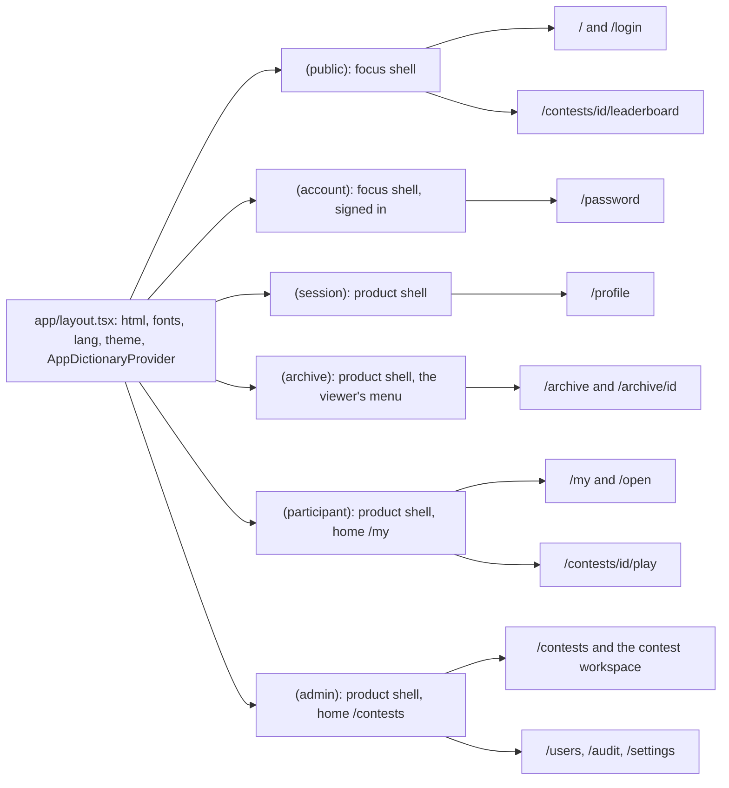
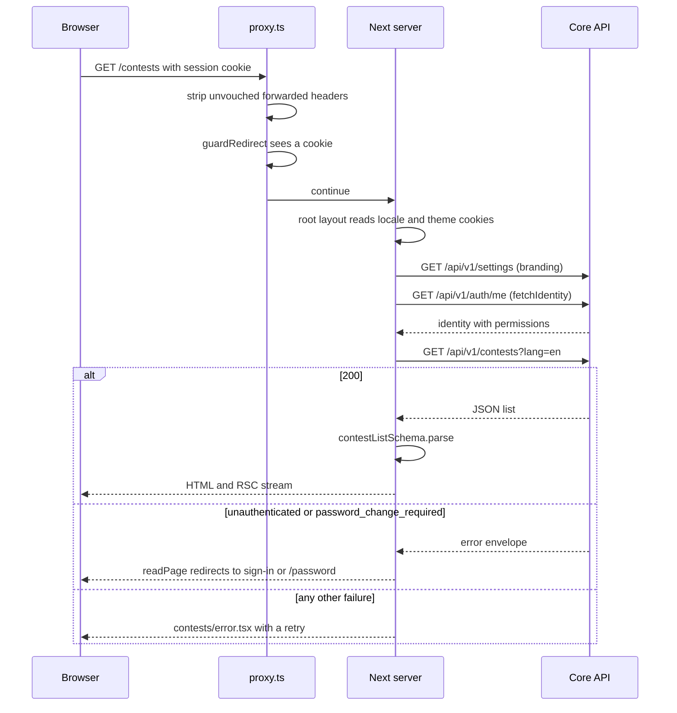
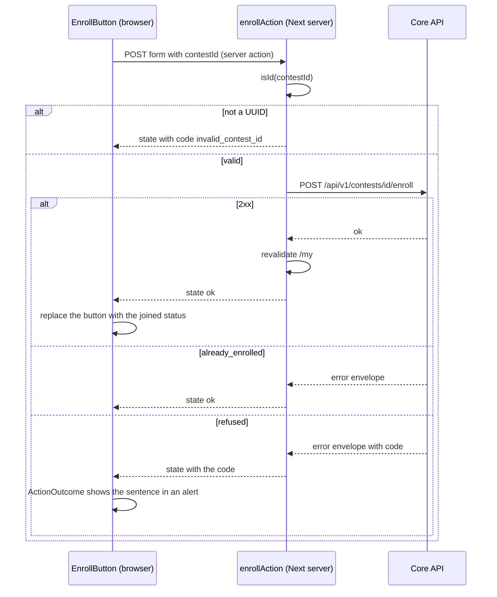
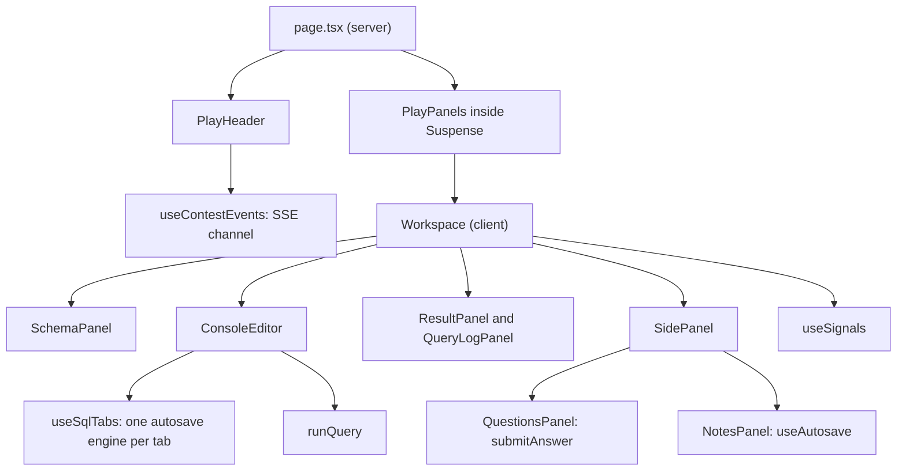

# 5. The frontend

This chapter is for a developer about to change the interface in `frontend/`.
It explains how the app is shaped, how a page gets its data and sends its
changes, where text and error messages come from, how the design system is
enforced, and how the play screen fits together. It ends with recipes.

The code map is [`frontend/README.md`](../../frontend/README.md). Read its
sections "The map", "Which direction things point" and "Where does a new thing
go?" first. This chapter builds on them and does not repeat them. Domain words
such as *registration*, *game instance* or *play screen* are defined in the
[glossary](01-overview.md#the-glossary).

The stack is Next.js 16 (App Router), React 19, Tailwind v4, TypeScript and
zod. Next.js 16 differs from older versions you may know: middleware is now
called **proxy** (`proxy.ts`), and route types such as `PageProps` are
generated. When you are unsure how a Next mechanism behaves, read the docs
that ship with the installed version in `frontend/node_modules/next/dist/docs/`
(see [`frontend/AGENTS.md`](../../frontend/AGENTS.md)).

## Contents

1. [The shape of the app](#1-the-shape-of-the-app)
2. [How a page gets its data](#2-how-a-page-gets-its-data)
3. [How a change is sent: server actions](#3-how-a-change-is-sent-server-actions)
4. [Text, languages and error messages](#4-text-languages-and-error-messages)
5. [The design system in practice](#5-the-design-system-in-practice)
6. [The play screen](#6-the-play-screen)
7. [Recipes](#7-recipes)
8. [Testing](#8-testing)
9. [Gotchas](#9-gotchas)

## 1. The shape of the app

### Route groups

Everything under `frontend/app/` is a route. A folder in parentheses is a
**route group**: it does not appear in the URL, but it gives every page inside
it the same layout. The app has six groups, one per audience.

| Group | Who it serves | Routes | Frame |
|---|---|---|---|
| `(public)` | anyone, signed in or not | `/`, `/login`, `/contests/[contestId]/leaderboard` | `public`: the focus shell |
| `(account)` | a signed-in account that must change its one-time password | `/password` | `account`: the focus shell, with sign-out |
| `(session)` | any signed-in account, participant or staff | `/profile`, `/profile/contests/[contestId]` | `session`: the product shell, no navigation |
| `(archive)` | any signed-in account, participant or staff | `/archive`, `/archive/[contestId]` | `archive`: the product shell, the viewer's own menu and home; 404 while the archive is off |
| `(participant)` | participants | `/my`, `/open`, `/contests/[contestId]/play` | `participant`: the product shell, home is `/my` |
| `(admin)` | contest authors and administrators | `/contests`, `/contests/new`, `/contests/[contestId]/…`, `/users`, `/users/[userId]`, `/audit`, `/settings` | `admin`: the product shell, home is `/contests` |

Two routes are Route Handlers rather than pages: `/healthz`, the container's
liveness probe, outside every group
([`app/healthz/route.ts`](../../frontend/app/healthz/route.ts)), and the play
screen's Markdown download inside the participant group
(`app/(participant)/contests/[contestId]/play/story.md/route.ts`).

Note that `/contests/[contestId]/…` exists in three groups: the staff
contest screens under `(admin)`, the play screen under `(participant)` and the public
table under `(public)`. Pick the group by audience, not by URL.

- The root layout is [`app/layout.tsx`](../../frontend/app/layout.tsx). It
  resolves the locale, the dictionary and the theme from cookies before the
  first byte, so there is no flash of the wrong theme or language.
- Each group's layout is its `layout.tsx`, which renders `Frame` with the
  group's audience:
  [`(public)`](../../frontend/app/(public)/layout.tsx),
  [`(account)`](../../frontend/app/(account)/layout.tsx),
  [`(session)`](../../frontend/app/(session)/layout.tsx),
  [`(archive)`](../../frontend/app/(archive)/layout.tsx),
  [`(participant)`](../../frontend/app/(participant)/layout.tsx),
  [`(admin)`](../../frontend/app/(admin)/layout.tsx).
- The frame is
  [`components/layout/frame.tsx`](../../frontend/components/layout/frame.tsx).
  One table, `AUDIENCES`, holds what each audience's frame differs in: the
  shell (`focus`, the bar alone, for signing in; `product`, the app bar with
  navigation and the account chip), where the mark leads, the menu, the
  dictionary scope (section 4), and what the frame does when the API cannot
  say who is reading. Everything else is the same for every audience. The
  not-found page outside every group wears the public frame.
- Each group has its own `not-found.tsx`, so a 404 inside a group keeps one
  header instead of stacking a second.

The staff frame builds its navigation from the permissions `/auth/me` returns
(`staffDestinations` in
[`components/layout/destinations.ts`](../../frontend/components/layout/destinations.ts)):
`/users` and `/registrations` appear only with `users.manage`, `/audit` with
`audit.view`, `/settings` and `/integrations` with `settings.manage`, and
`/archive` while the installation's archive is on. A role that gains a
permission as data gets the link with no code change. An account with no staff
permission that manages a contest (`manages_contests` in `/auth/me`) also lands
on `/contests` and gets this menu; the register's "New contest" link needs
`contest.create`.

### How access is enforced

Three layers, from the edge inward:

1. **`proxy.ts`** ([`frontend/proxy.ts`](../../frontend/proxy.ts)) runs on
   every request except static assets. Next 16 runs proxy on Node. It first
   removes forwarded-address headers the reverse proxy did not vouch for
   (section 2 explains why). Then, for any path not under `/api/`, it calls
   `guardRedirect` from [`lib/auth/guard.ts`](../../frontend/lib/auth/guard.ts).
2. **`guardRedirect`** decides from the path and whether the session cookie
   exists, under the name `sessionCookie()` in
   [`lib/auth/session.ts`](../../frontend/lib/auth/session.ts) gives it:
   `__Host-dbcontest_session` where `COOKIE_SECURE` is on,
   `dbcontest_session` otherwise. The cookie is httpOnly and opaque here,
   so this check knows only that a cookie is present, not whether it is
   valid. Paths reachable without a cookie are listed in `guard.ts`:
   `PUBLIC_PATHS` (`/` and `/login`), `PUBLIC_EXACT` (`/healthz`) and
   `PUBLIC_PATTERNS` (a contest's leaderboard). Everything else redirects to
   `/login?next=<path and query>`.
3. **The Core API** decides everything else. A page reads the API through
   `readPage` (section 2). When the answer is `unauthenticated` (a stale
   cookie) or `password_change_required`, `readPage` redirects to sign-in or
   to `/password` through `authRecoveryRedirect` (same file as
   `guardRedirect`). `forbidden` is not redirected: the account is signed in,
   and signing in again would not help. Screens that load one contest answer
   `forbidden` as not found: their read policy sets `hideForbidden` (see
   `loadContest` in `app/(admin)/contests/[contestId]/contest.ts`).

The server-side identity check is `fetchIdentity()` in
[`lib/auth/session.ts`](../../frontend/lib/auth/session.ts). It calls
`GET /api/v1/auth/me` with the session cookie and is wrapped in React's
`cache()`, so the frame and the page of one request share a single round
trip. It returns `null` when there is no cookie or the API answers 401, and
throws `IdentityUnavailableError` on
any other failure, so an API restart does not look like a sign-out. A frame
where the identity only decorates (`participant`, `admin`) reads it through
`readIdentity` in [`lib/auth/identity.ts`](../../frontend/lib/auth/identity.ts)
instead, which answers `null` on an outage and logs it once per render; the
frame then renders without the account chip and the permission-gated links.
The `session` and `archive` frames read `fetchIdentity` and let an outage
reach the error boundary, since the identity decides where their mark leads;
the `session` frame redirects to sign-in on `null`.

The frontend never decides what an account may do. It hides links the account
cannot use, and the API refuses what it may not do.

## 2. How a page gets its data

### Server components call the API through `lib/api`

Pages are Server Components by default. They read the Core API on the server
and pass plain values to Client Components. The transport lives in
[`lib/api/`](../../frontend/lib/api/):

| File | Role |
|---|---|
| [`client.ts`](../../frontend/lib/api/client.ts) | `request(path, options)`: the framework-free transport. Prefixes `/api/v1`, serialises `body` as JSON, returns `undefined` for 204, and turns any failing response into an `ApiError` with `code`, `status`, `requestId`, and optional `subject`, `position` and `retryAfterSeconds`. A non-JSON failure (a gateway's HTML page) becomes code `unreachable`. |
| [`outcome.ts`](../../frontend/lib/api/outcome.ts) | `outcome(call)`: runs one call and returns its value or why there is none (`code`, and `requestId`, `subject`, `position`, `retryAfterSeconds` when the API sent them), so no caller writes its own `catch`. Anything the API did not answer in its own terms is `unreachable`. Next's redirects, not-found and prerender bail-outs pass through, and so does the caller's own abort. A failure is logged without its message. `bestEffort(call, path)` is a read the caller works without: its value, or `null` with the failure logged. |
| [`server.ts`](../../frontend/lib/api/server.ts) | `serverRequest(path, options)`: `request` with the API's private origin (`apiOrigin()`), the forwarded headers, the session cookie and a 30-second deadline added. `serverAction` and `serverOutcome` run it for a server action (section 3) and revalidate what changed only once it worked; `ActionState` is the state a form bound to an action holds. |
| [`page-read.ts`](../../frontend/lib/api/page-read.ts) | `readPage(path, parse, policy)`: how a page reads. One request per path per render, shared by a layout, its page and their metadata; the policy says how the page answers a refusal. |
| [`browser.ts`](../../frontend/lib/api/browser.ts) | `browserRequest(path, options)`: `request` from the page's own origin with the session cookie, throwing an `ApiError`. `browserCall(call)` runs such a call into the state a screen renders, `refused` with the code instead of a throw. |
| [`caller.ts`](../../frontend/lib/api/caller.ts) | `callerHeaders()`: binds `forwardedHeaders` to the current Next request. |
| [`forwarded.ts`](../../frontend/lib/api/forwarded.ts) | Decides which client headers may be passed on to the API. |
| [`config.ts`](../../frontend/lib/api/config.ts) | `apiOrigin()` reads `API_ORIGIN` (falls back to `http://localhost:8080` only outside production) and `ingressSecret()` reads `INGRESS_SECRET`. |
| `ids.ts` | `isId(value)`: whether a value is a UUID and safe to put into a request path. `pathSegment(name)`: a name (a table, a row) encoded as one path segment, or `null` for an empty name, `.` or `..`, which would move the request path. |
| `<area>.ts` | zod schemas for one area of the API (`contests.ts`, `play.ts`, `workspace.ts`, …) and, in some modules, the functions that call it. |
| `<area>-terms.ts` | Constants and small helpers from the same area, with no zod. |

**Why `forwarded.ts` exists.** Every request the API sees comes from the Next
server, so without help the API's login throttle, a contest's network
restriction and the audit trail would all see the Next server's address. The
Next server therefore passes `X-Forwarded-For` (and the user agent) on, but
only when the request carries the `x-ingress-secret` header that Caddy adds
with the shared `INGRESS_SECRET`. Without that proof the address is the
browser's own claim and is dropped. `proxy.ts` strips unvouched forwarded
headers on every path, including `/api/*`, which the `next.config.ts`
rewrite forwards to the API when no reverse proxy is in front. The trust rule
on the API side is CLAUDE.md, security rule 9.

**Why responses are parsed with zod.** Each area module declares a schema that
parses the API's snake_case JSON and transforms it to camelCase once. A
changed contract fails at the boundary with a field name instead of
surfacing as `undefined` three components later. `contestSummarySchema` in
[`contests.ts`](../../frontend/lib/api/contests.ts) is a typical one.

**Why `*-terms.ts` files exist.** A schema module calls `z.object()` when it
loads, so a bundler cannot drop it. A Client Component that imports one
constant array from `contests.ts` would ship all of zod (about 110 KB
minified, 31 KB gzipped) to the browser. The vocabulary (enum arrays, tone
maps, page sizes, status predicates) lives in `contests-terms.ts`,
`content-terms.ts`, `querylog-terms.ts` and the like; the schema modules
import from there, so each term is defined once. The reason is written down in
[`content-terms.ts`](../../frontend/lib/api/content-terms.ts). `npm run lint`
holds client files to it: the rule `bundle/no-schema-in-client`
([`scripts/no-schema-in-client.mjs`](../../frontend/scripts/no-schema-in-client.mjs))
follows a `"use client"` file's value imports and refuses one that brings in
zod. The one exception is an import of a function that calls the browser
adapter (`lib/api/browser.ts`), since that call parses the API's answer with
zod anyway.

### A server-rendered page, traced

The contest register at `/contests`
([`app/(admin)/contests/page.tsx`](../../frontend/app/(admin)/contests/page.tsx))
is a typical read.

- `proxy.ts` and `lib/auth/guard.ts` run first. Without a cookie the browser
  would be redirected to `/login?next=%2Fcontests` here.
- `app/(admin)/layout.tsx` renders the `admin` frame, which reads branding
  (`lib/api/branding.ts`) and the identity in one `Promise.all`; the identity
  decides the navigation links. The diagram draws the two reads one after the
  other for readability.
- The page calls `readPage(path, parse, { here })` from
  `lib/api/page-read.ts`. It sends the request through `serverRequest`, which
  adds `callerHeaders()` and `sessionHeader()`, and parses the answer with
  `contestListSchema`.
- The page writes no `catch`. `readPage` keeps three rules on every read: a
  dead session goes to sign-in and a one-time password to `/password`; the
  code `not_found`, never a status, renders the not-found page; Next's own
  redirects and not-found pass through. Anything else is thrown and lands in
  [`app/(admin)/contests/error.tsx`](../../frontend/app/(admin)/contests/error.tsx).
  In production Next reduces a Server Component error to a digest, so the
  error boundary cannot see the API code. A page names the codes that matter
  to it in its policy, and `readPage` answers them before anything is thrown:
  - `missing`: codes besides `not_found` that mean the page's own subject is
    not there, answered with the not-found page;
  - `hideForbidden`: `forbidden` answered as not found, where whether the
    thing exists is not the caller's business;
  - `absent`: an ordinary absence the page renders, answered as `null` and
    never logged;
  - `shown`: a refusal whose sentence the page shows in place of what it read,
    such as the reader's own rate limit, answered as a `Refusal` (rendered with
    `RefusalNote` from `components/product/refusal-note.tsx`);
  - `bestEffort`: the page renders without this read, which answers `null`
    and logs the failure, unless the failure would have been the not-found
    page, since anyone can ask for an address that leads nowhere.
- The page asks for contest text in the interface language (`lang=<locale>`),
  so a page never mixes two languages.

### Browser-side reads and writes

Most data flows through the Next server. A few calls go from the browser
straight to the API, same-origin through `/api/v1` (Caddy in production, the
`next.config.ts` rewrite otherwise), using `browserRequest` or `browserCall`
from `lib/api/browser.ts`:

- everything the play screen sends or reads while the contest runs: queries,
  answers, the question list, the query log, the standings, the schema, the
  database reset and the questions to the organisers (`play/requests.ts`),
  and the autosave of notes and SQL
  tabs with its browser signals (`lib/api/workspace.ts`). Next dispatches a
  page's server actions one at a time, so as actions an answer would wait
  behind a running query (section 6); the autosave additionally needs a
  `keepalive` fetch as the page closes, which an action cannot make;
- the live monitoring reads (`lib/api/monitor.ts`), the profile's query
  pages (`lib/api/profile.ts`), and the staff desk of participants' questions,
  which polls its queue every five seconds and answers and announces from the
  same place (`lib/api/clarifications.ts`,
  `app/(admin)/contests/[contestId]/clarifications/`);
- the game's chunked uploads: a dump that replaces the game database
  (`game/game-upload.tsx`) and a builder table's CSV data
  (`game/game-builder-table.tsx`), both under
  `app/(admin)/contests/[contestId]/`. Both send their chunks through one loop,
  [`game/chunk-upload.ts`](../../frontend/app/(admin)/contests/[contestId]/game/chunk-upload.ts),
  streamed from the file as `rawBody` `Blob` slices without passing through
  the Next server. Every chunk is sent from the server's count, never the
  tab's own tally. A chunk refused as busy (`game_upload_busy`,
  `game_table_data_busy`) was not stored and is sent again by itself after its
  `Retry-After`, held between 1 and 60 seconds; five such refusals in a row
  leave it to the organiser's Retry. An out-of-order refusal resyncs against
  the server's count, at most three times in a row. Leaving the screen aborts
  the chunk in flight and leaves the upload to be resumed;
- the play screen's Server-Sent Events channel (section 6);
- the PDF files an administrator downloads: the story from the story screen,
  and the results table or protocol from the standings export. All are made
  in the browser by one engine in [`lib/pdf/`](../../frontend/lib/pdf/):
  `renderPdf` in `render.ts` loads `pdfmake` with a dynamic `import()` on the
  first click, so no route's first load carries the library, fetches the faces
  from `public/fonts/pdf/`, draws the logo and fits the running header's
  title; each document only builds its definition
  (`app/(admin)/contests/[contestId]/story/pdf/` for the story,
  `standings/export/pdf/` for the results). The library is plain JavaScript,
  so it runs under the production content policy unchanged. The story's
  Markdown goes through the same `react-markdown` pipeline as `StoryText`, and
  every typographic value is `StoryText`'s, converted at 10 pt to the rem
  (`lib/pdf/theme.ts`, held to `globals.css` and `tokens.css` by its test).

There are no `NEXT_PUBLIC_` variables. The browser never needs the API's
address, because the API shares the page's origin.

## 3. How a change is sent: server actions

A mutation is a **server action**: an `async` function in a file marked
`"use server"`, conventionally the route's own `actions.ts`. A Client
Component binds it to a `<form>` with `ActionForm` from
[`components/product/action-form.tsx`](../../frontend/components/product/action-form.tsx).
The action runs on the Next server, calls the API through `serverAction` (or
`serverOutcome`, when it needs the answer itself) from `lib/api/server.ts`,
and returns a small state object: an `ActionState`, which holds nothing yet,
`{ ok: true }` or a refusal's `{ code }`, never both, plus whatever extras the
form needs. It never returns the API's English message.

Patterns an action must follow:

- **Validate ids before they reach a path.** Form fields are forgeable, and
  `fetch` resolves `..`, so `/contests/${id}/enroll` could address a different
  endpoint. Use `isId` from `lib/api/ids.ts`, and `pathSegment` for a name
  that becomes a segment. Every action file that builds a path from a field
  does this.
- **Return a code, not text.** `serverAction` turns a failure into
  `{ code }`: the API's code, or `unreachable` when the API never answered.
  Nothing else of a refusal reaches the browser unless the action's
  `failure` names it (the `subject` a sentence quotes).
- **Revalidate what changed** by naming it in `revalidate`; the paths are
  revalidated only once the call worked. Every action that writes a contest
  revalidates through `contestChanged(contestId)` from
  `app/(admin)/contests/[contestId]/revalidation.ts`: the workspace header,
  the publish gate and the version every form that saves the contest or its
  content sends all read the contest, and a stale version refuses the
  organiser's next save from any of them. To move to the next screen, run the
  call with `serverOutcome` and call `redirect()` once it has returned,
  outside the call.
- **The form shows the sentence.** Inside `ActionForm`, `ActionButton` is the
  submit button, disabled while the action runs; `ActionOutcome` shows the
  refusal's sentence, or the screen's "saved" once the save worked;
  `ActionFooter` is the usual save row of both. The sentence always comes from
  the dictionary (`messageForCode`), in `FailureAlert`, the one alert style
  every form uses, so a code never reaches the screen. A screen whose request
  is not an action renders `FailureAlert` itself.

What `ActionForm` keeps for every form, so a screen does not handle it:

- **A refusal keeps what was typed**, once the page has hydrated. Only
  password fields are cleared, so a password is not left on screen for the
  next person at the machine. The fields start over only after a save that
  worked, from the server's copy (`revision` names the version they show), or
  on a reload under a refusal (`ActionReload`, below). A submission before
  hydration, or without JavaScript, is a native POST, and the page the server
  sends back starts its fields afresh.
- **It works without JavaScript.** The form renders as a native POST to its
  server action, so one submitted before the page hydrates, or with no
  JavaScript at all, still reaches the action. An end-to-end test signs in
  with JavaScript off (`e2e/admin.spec.ts`). A form that asks first is the
  exception: its button waits for hydration, because the question needs it.
- **A destructive form asks first** through its `confirm` prop: a question,
  or a function of the data about to be sent. The question is the product's
  own dialog (`useConfirm` in
  [`components/ui/use-confirm.tsx`](../../frontend/components/ui/use-confirm.tsx)),
  in the interface's language, never the browser's `confirm()`. A yes covers
  only the data it was asked about, and the answer stays disabled for
  `CONFIRM_ARM_MS` after the question opens, so the second click of a
  double-click cannot land on it. A name the user chose goes into the question
  through `isolate` (section 4). If the dialog cannot be loaded, nothing is
  sent and the form says so.
- **A contest that moved meanwhile** is refused with `contest_changed`: for
  the forms that save the contest or its content, which send the `version`
  they were loaded at, since they were rendered; for status actions and the
  reveal, which send none, only while the save is decided. The guarded forms
  are the settings, prize-places, archive, languages and SQL policy panels,
  the title editor, the story and table descriptions, the question list
  (add, move, delete) and question editor, and the game's script editor and
  table-builder structure; the game's uploads, build and single rows send
  none. The question delete sends the version as `?expected_version=`, since
  a proxy may drop the body of a `DELETE` (`versionIn: "query"`). They
  take their hidden fields from `atVersion` in `lib/api/contests-terms.ts`,
  their actions send the version through `saveAtVersion`
  (`app/(admin)/contests/[contestId]/save-at-version.ts`), and every one of
  them moves the one version, so each save revalidates the workspace and
  hands every untouched form the new one. An edited form keeps the version
  its draft was based on (ActionForm's `version`: pinned at the first input or
  change event in the form, or at `useDraftEdited` for a change made by a
  button or held in state; released by a save of its own that worked or a
  reload). An edit made while that save was sending keeps its pin, based on
  the version the save's answer names in `Contest-Version`
  (`CONTEST_VERSION_HEADER`, pinned to `docs/api/limits.json` by
  `lib/api/limits-contract.test.ts`), which
  `saveAtVersion` hands back as the state's `version`: saved again it lands,
  and a colleague's later write still refuses it. It keeps the server copy it
  shows the same way: a newer copy (`revision`, which `atVersion` requires and
  which names everything the fields show, the title dialog's languages
  included, so no guarded form can show an old copy at a fresh version;
  `NO_DRAFT` for a form of buttons and hidden fields alone) remounts an
  untouched form with it, but never replaces an edited draft, whose save is
  then refused instead. A screen reads the contest before its content
  (`loadContestResource` waits for the render's one read of the contest), so a
  write landing between the two reads leaves a
  newer copy at an older version, which refuses, never the reverse. So a sibling save or an
  unguarded action
  that re-reads the page makes it refuse with the reload rather than write a
  stale draft over a colleague's change. One organiser editing two forms of a
  page at once and saving one is then refused on the other, the accepted
  cost. A draft a screen holds in state lives inside the form (`ScriptEditor`,
  `StructureEditor`, `LanguageFields`, `PolicyFields`, `QuestionFields`,
  `PerLanguageFields`), so the reload's restart rebuilds it from the re-read
  page. The version is the contest's, so a tab
  left open is refused after any write to its contest, even one to another
  question: parallel tabs of one contest see more refusals than their edits
  strictly conflict. A status action whose status moved
  during the save is refused as `status_changed` instead, which offers no
  reload. Under `contest_changed`, `ReloadWhenChanged`
  (`app/(admin)/contests/[contestId]/reload-when-changed.tsx`) offers a
  reload, which re-reads the page and starts the form over with the fresh
  copy. Every form that can get it carries it.

### A form submitted through a server action, traced

Joining a contest from the participant's register, which `/my` and `/open`
share (`app/(participant)/participant-register.tsx`): the button is
[`app/(participant)/enroll-button.tsx`](../../frontend/app/(participant)/enroll-button.tsx),
the action is
[`app/(participant)/enroll-actions.ts`](../../frontend/app/(participant)/enroll-actions.ts).

- `ActionForm` binds the action and its hidden `contestId` field; its
  children are a function of the state, so the row shows the joined status
  once the state is `ok`. `ActionButton` is disabled while the request is in
  flight.
- `enrollAction` treats `already_enrolled` as success, without revalidating:
  a double click or a stale list both mean the account got what it asked for.
- The API decides the contest's own rules (closed enrolment, deadline,
  network). The action cannot check the network itself: only the trusted
  proxy knows the address that counts.
- A submission made before hydration is the form's own POST to the server
  action, as it is with no JavaScript at all; it does not wait for the page
  to hydrate.

The Next client dispatches server actions one at a time (see
`node_modules/next/dist/docs/01-app/02-guides/server-actions.md`, "Sequential
dispatch on the client"). That is why the play screen uses none while the
contest runs: anything queued behind a running query would wait for it
(section 6).

## 4. Text, languages and error messages

### The dictionaries

Every user-visible string lives in a dictionary in
[`lib/i18n/dictionaries/`](../../frontend/lib/i18n/dictionaries/): `en.ts`,
`ro.ts` and `ru.ts`. The locales are declared in
[`lib/i18n/config.ts`](../../frontend/lib/i18n/config.ts) (`LOCALES`,
`DEFAULT_LOCALE = "en"`).

`en.ts` is the source. Its shape, widened to plain strings, is the exported
`Dictionary` type, and `ro.ts` and `ru.ts` end with `satisfies Dictionary`. A
key added to `en.ts` and missing from another locale is a type error.
`lib/i18n/dictionary.test.ts` also checks that every locale carries every key,
and that audit actions, publish-gate problems and login-failure reasons have
a translation everywhere.

The rule: **user-visible text lives only in the dictionaries, in every
locale.** Components take a `dict` (or a slice of one) as a prop and hold no
strings of their own. A URL may select a sentence (the sign-in page's
`?changed=1`) but never supply text. The repository's language rule is
CLAUDE.md, general rule 3: code is English, interface text exists in every
locale.

### How a string is looked up

The language comes from one place, the `dbcontest_locale` cookie. There is no
`Accept-Language` negotiation and no locale in the URL; an unknown value reads
as `en` (`lib/i18n/locale.ts`). The language switcher posts to the
`chooseLocale` server action in `components/layout/locale-actions.ts`, which
sets the cookie and revalidates the layout.

- **On the server**, call `activeLocale()` and `activeDictionary()` from
  [`lib/i18n/server.ts`](../../frontend/lib/i18n/server.ts). The dictionary is
  loaded on demand per locale (`lib/i18n/dictionary.ts`), so a page ships only
  its own language. Pass what the component needs as a prop.
- **On the client**, prefer the prop. A client boundary that cannot receive
  props, chiefly `error.tsx`, reads a **dictionary scope** from context:
  `AppDictionary.use()`, `ParticipantDictionary.use()`,
  `SessionDictionary.use()`, `ArchiveDictionary.use()` or
  `AdminDictionary.use()` from
  [`lib/i18n/client.tsx`](../../frontend/lib/i18n/client.tsx). Each
  audience's frame provides its scope.

A scope carries only some sections of the dictionary, listed in
[`lib/i18n/scopes.ts`](../../frontend/lib/i18n/scopes.ts): `APP_SECTIONS` is
`screens`, `PARTICIPANT_SECTIONS` is `participant`, `SESSION_SECTIONS` is
`profile` and `participant`, `ARCHIVE_SECTIONS` is `archive`,
`ADMIN_SECTIONS` is `contests`, `accounts`, `audit` and `settings`.
Everything handed to a Client Component is serialised into the page payload, and the whole dictionary was about half of the play
route's payload. Reading a section the scope does not carry does not compile.
The play screen narrows further with its own `PlayDictionary` (section 6).

Placeholders are `{name}` tokens filled by `fill(template, values)` from
[`lib/i18n/fill.ts`](../../frontend/lib/i18n/fill.ts), for example
`fill(t.startsAt, { time: startsAt })`. It replaces every occurrence in one
pass and literally, so a value that reads like a replacement pattern (`$&`) or
like another placeholder stays text. A placeholder with no value stays visible
in production and throws under test, so a mistyped key fails a test. A name a
user chose (a login, a contest title, a table) goes through `isolate(name)`
first: it is stripped of its own direction controls and set apart from the
sentence, so it cannot reorder the words around it.

A sentence keyed by something the server chose (an error code, a status, a
skip reason) is looked up with `labelFor(section, key)` from
[`lib/i18n/label.ts`](../../frontend/lib/i18n/label.ts). It finds only the
section's own keys, so a key such as `constructor` does not find what every
object inherits; the caller decides what an unknown key shows.

### From an API error code to a sentence

The API answers a failure with a machine code (`error.code`) and an English
message for developers. The interface shows only its own sentence for the
code:

1. `request()` turns the response into an `ApiError` carrying `code`.
2. `outcome` (section 2) hands the code on: a page's read policy answers it,
   an action returns `{ code }`, a browser call returns `refused` with it.
3. The screen shows it through `ActionOutcome` or `FailureAlert` (section 3),
   or `RefusalNote` for a refusal a page shows in place of what it read. Each
   calls `messageForCode(code, dict.errors)` from
   [`lib/i18n/errors.ts`](../../frontend/lib/i18n/errors.ts), which looks the
   code up among the `errors` section's own keys and falls back to
   `errors.fallback` for a code this build does not know.

The API publishes its codes as data in
[`docs/api/error-codes.json`](../../docs/api/error-codes.json), generated from
the Go declarations by `make api-contract`. `npm run error-codes`
([`scripts/error-codes.mjs`](../../frontend/scripts/error-codes.mjs)) compares
that file with the `errors` section of every dictionary. It fails on a code
the API returns and a locale lacks (`missing`), and on a code a locale still
translates that the API no longer returns (`unused`). Three codes are invented
by the frontend and exempt: `fallback`, `unreachable` and `password_mismatch`.
How a code is declared on the Go side is in [04-backend.md](04-backend.md)
and CLAUDE.md, security rule 1.

### Bounds the interface repeats

A field stops at the API's bound, and a sentence states it, so the interface
repeats some Go bounds: a constant in the area's `*-terms.ts` (or
`lib/auth/signup-rules.ts`), named in its comment by the Go identifier it
repeats (`NOTES_MAX_CHARS` is `workspace.MaxNotesRunes`). The API publishes
those bounds too: `make api-contract` also writes
[`docs/api/limits.json`](../../docs/api/limits.json) from `cmd/apicontract`,
each entry under its Go identifier, with the durations, the contest's status
transitions and the chosen-login pattern beside them.
[`lib/api/limits-contract.test.ts`](../../frontend/lib/api/limits-contract.test.ts)
compares every constant with that file. A bound must equal the API's, a page
size the interface sends must be at most the API's maximum, and the few rules
kept in a function are checked by what the function does. An entry the test
does not check fails it, so a bound changed on one side only is a red test,
not a refusal the field should have prevented.

A sentence never spells a bound out. It names a placeholder such as
`{notesMaxChars}`, listed in `BOUNDS` in
[`lib/i18n/bounds.ts`](../../frontend/lib/i18n/bounds.ts) with the constant it
is filled from, in the unit the sentence speaks of. `getDictionary` fills these
placeholders once per locale when the dictionary loads, writing each number as
the locale writes it, and leaves every other placeholder for `fill` at render.
`lib/i18n/bounds.test.ts` fails on a bound left unfilled, on one no sentence
states, on a locale whose sentence names other bounds than English, on a
bound whose value moved a Romanian or Russian sentence into another plural
category, and on a placeholder that is neither a bound nor a name a screen
fills.

## 5. The design system in practice

The visual specification is [`docs/design/SPEC.md`](../../docs/design/SPEC.md).
This section covers how the code holds to it.

**Tokens.** [`styles/tokens.css`](../../frontend/styles/tokens.css) is the
only place a colour, a control size (`--control-h`), a duration or a radius is
written. The light theme is on `:root`. The dark theme redefines the semantic
tokens twice: under `:root[data-theme="dark"]` (the visitor chose dark) and
under `prefers-color-scheme: dark` (the visitor follows the system).
[`app/globals.css`](../../frontend/app/globals.css) imports the tokens and maps
them to Tailwind utilities in its `@theme` blocks. The type scale (the size,
line height, tracking and weight of each step) is written there, in `@theme`,
not in `tokens.css`. `globals.css` also erases Tailwind's stock `--text-*`,
`--radius-*` and `--tracking-*` scales, so only the project's steps exist
(`text-display`, `text-h2`, `text-body`, `text-small`, `text-label`,
`text-data`, …). There are no `dark:` utilities: switching theme swaps
variables.

**Three component folders.**

| Folder | What goes there | Examples |
|---|---|---|
| `components/ui/` | Primitives with no domain knowledge. Classes are merged with `cn()` from `lib/utils.ts`; variants are declared with `class-variance-authority` where a primitive has them (`button.tsx`, `tag.tsx`). Sizes come from `--control-h`, colours from tokens. | `button.tsx`, `input.tsx`, `field.tsx`, `tag.tsx`, `tabs.tsx`, `dialog.tsx`, `combobox.tsx`, `use-confirm.tsx` with `confirm-dialog.tsx` (the one way to ask before a step that cannot be taken back) |
| `components/product/` | Domain components used by more than one route. | `action-form.tsx` (a form bound to a server action, section 3), `refusal-note.tsx`, `reload-button.tsx`, `state-view.tsx`, `standings.tsx`, `code-editor.tsx`, `query-row.tsx`, `export-menu.tsx` |
| `components/layout/` | The frame the whole app wears. | `frame.tsx` (one frame per audience, section 1), `destinations.ts`, `band.tsx`, `app-bar.tsx`, `language-switcher.tsx`, `theme-toggle.tsx` |

`StateView` (`components/product/state-view.tsx`) is the shared renderer for
the spec's states: `empty`, `empty-filtered`, `error-recoverable`,
`error-terminal` and `blocked`. Its type makes the rules hold: a filtered
empty state requires a reset link, a recoverable error requires a retry.

**ESLint design-system rules.** [`eslint.config.mjs`](../../frontend/eslint.config.mjs)
adds one `no-restricted-syntax` rule with three patterns, checked in string
literals and template literals:

- no arbitrary colour (`bg-[#…]`, `text-[rgb(…)]` and the like);
- no arbitrary type (`text-[…]`, `tracking-[…]`, `leading-[…]`);
- no `font-bold`, `font-extrabold` or `font-black`: the system has no weight
  700, and `font-semibold` is the ceiling.

**The checks behind them.**

| Command | What it proves |
|---|---|
| `npm run lint` | the three rules above, plus Next's own lint set |
| `npm run contrast` | every token pair listed in `scripts/contrast.mjs` meets its WCAG threshold (4.5:1 for text, 3:1 for control edges), in both themes |
| `npm run type-scale` | every `text-*` class names a real type step or colour; an unknown step would otherwise emit no CSS and fail silently |
| `lib/design/tokens.test.ts` (in `npm test`) | every colour class used in `app/` and `components/` exists in `globals.css` |

## 6. The play screen

`app/(participant)/contests/[contestId]/play/` is the participant's olympiad
screen and the most involved area of the frontend. Hundreds of participants
open it in the same minute, so much of its code is about payload size, request
budgets and surviving a closed tab.

### The parts

| File | What it is |
|---|---|
| `page.tsx` | Server Component. Finds the contest in the participant's enrolled listing, shows a waiting room for `published`, "not available" for other non-running statuses, and for `running` builds the workspace from `readPlay`, or shows the refusal that takes the screen instead. |
| `play-reads.ts` | `readPlay`: the story, questions, query log, schema and workspace, read in parallel through `readPage` and settled apart, so a refusal about the story alone does not lose the rest. A refusal that means the participant may not use the screen now (the contest closed or not open for them, a disallowed address, not on the roster, the read rate limit) takes the whole screen; the log, the schema and the workspace are best-effort. |
| `dictionary.ts` | `PlayDictionary`: the `participant`, `errors` and `leaderboard` sections only. |
| `play-header.tsx` | Title, clock and panel toggles. The only place that opens the events channel. Rendered outside `<Suspense>` so it streams before the slow reads. |
| `workspace.tsx` | The full-screen grid: schema panel, console, bottom panel (Result and Query log tabs), side panel. Here "workspace" names the screen's layout; the server-side *workspace* in the glossary is the participant's notes and SQL tabs. |
| `console.tsx` | The SQL editor (`components/product/code-editor.tsx`, CodeMirror), the SQL tab strip and the Run button, bound to `runQuery`. The editor completes PostgreSQL's keywords and functions and, unless the contest hides its schema, the game's tables and columns (`components/product/sql-completion.ts`). |
| `sql-tabs.tsx`, `use-sql-tabs.ts` | The tab strip (draws only) and its state: which tabs exist, which is open, one autosave engine per tab. |
| `result-panel.tsx`, `row-detail.tsx` | The last query's result or refusal; one row opened in full. |
| `query-log-panel.tsx` | Every statement this participant ran, paged by `QUERY_LOG_PAGE_SIZE`; a row opens to its whole statement with a Copy button, read from the server when the page carried only its start. |
| `side-panel.tsx` | Tabs for story, questions, questions to the organisers, notes and leaderboard; the story's Markdown and print exports; the dot on the organisers' tab while something new is unread, which scrolls that tab into view and is repeated on the side panel's toggle in the header (`panel-toggles.tsx`). |
| `questions-panel.tsx` | The questions (rendered to HTML on the server) and one answer form each, bound to `submitAnswer`. |
| `notes-panel.tsx` | One self-saving notes field. |
| `clarifications-panel.tsx`, `clarification-text.tsx` | Questions to the organisers: the form (a question picker that never offers a locked question, the text with its counter, Ctrl/⌘+Enter), the announcements and the questions with their answers. A participant's text is shown as typed; the organisers' answers and announcements through `StoryText`, a lazy chunk. Read on mount, a random moment within ten seconds after each `clarification` hint (the newest page only; older pages load again on demand), and on a reconnect; what was seen is kept per account and contest in `localStorage`. Read-only once the contest is over for the participant. |
| `clarification-signal.tsx` | Carries the channel's `clarification` hints, admitted connections and finish from the header to the side panel, across the Suspense boundary. |
| `schema-panel.tsx`, `table-query.ts` | Tables, columns, types and foreign keys; a click on a table's name writes `SELECT * FROM <table> LIMIT 5;`, quoted as PostgreSQL needs, into the open SQL tab, and the chevron opens the table. Absent when the organiser hides the schema. It shows the game's build, not the participant's own tables; re-read after a database reset, which changes it only if the game was rebuilt meanwhile. |
| `schema-diagram-dialog.tsx`, `schema-diagram.tsx`, `schema-diagram-layout.ts`, `schema-diagram-positions.ts` | The schema panel's "Diagram" button (offered unless the contest switches it off) and the large view it opens: tables as boxes with their primary and foreign keys marked, an arrow from each foreign-key column to the column it references, panned and zoomed by pointer, wheel and keyboard, with the relations as a list for a screen reader. A table is moved by dragging it, or by Tab and the arrow keys; where it was moved is kept in `localStorage` per contest and per set of table names, and "Arrange" returns to the automatic layout. The layout puts a hub's leaf tables on both sides of it, reorders each rank by the rows its arrows leave from, folds a long chain into bands and sets keyless tables below or beside the graph, whichever fits the dialog larger. The drawing and its layout engine (`@dagrejs/dagre`) are a lazy chunk fetched when the button is hovered, focused or pressed. Past a measured budget of edge segments the layout ranks the tables itself instead of calling dagre, so a 200-table schema opens in under half a second. |
| `reset-database.tsx` | The "Reset database" control in the console toolbar, offered only by a `read_write` contest (the listing's `sql_mode`). A confirmation dialog, bound to `resetDatabase`, that stays open until it can say how the reset went. It keeps its own dialog for that reason rather than `useConfirm`, and arms its answer the same way, so a double click does not reset twice. |
| `panel-toggles.tsx`, `pane-splitter.tsx` | Collapsible panels with keyboard shortcuts; draggable, remembered pane sizes. The provider also holds which pane a phone shows. |
| `pane-switch.tsx` | Below 760 px the workspace shows one pane at a time; this is the switch that chooses it (Editor, Result, Schema, Questions). The panes stay mounted. |
| `use-autosave.ts` | The autosave engine for notes and SQL tabs. |
| `use-contest-events.ts` | The Server-Sent Events channel and the corrected clock. |
| `use-signals.ts` | Page-left and paste signals reported to the organiser. |
| `refusals.ts` | What each refusal code means for this screen. |
| `content-loaded.tsx` | Tells the header, across the Suspense boundary, whether the workspace or a refusal rendered. |
| `requests.ts` | Browser-side requests to the API: run a query, submit an answer, refresh questions, page the query log and read one row of it whole, read the standings, reset the database, re-read the schema, read the questions to the organisers and ask one. Not server actions; see below. |
| `story.md/route.ts` | Route Handler: the story as a Markdown download. |
| `print-view.tsx`, `story-cover.tsx`, `skeleton.tsx`, `loading.tsx` | Print copy, cover picture, loading skeleton. Under the read rate limit the page offers `ReloadButton` from `components/product/reload-button.tsx`, which re-reads the page in place. |

The deeper rationale is in docs/ARCHITECTURE.md: the workspace in
[§6.4](../ARCHITECTURE.md#64-a-participants-workspace-notes-and-sql-tabs), the
clock in [§8](../ARCHITECTURE.md#8-the-contest-clock), signals and monitoring
in [§9.4](../ARCHITECTURE.md#94-watching-a-participant).

### Queries and answers go straight to the API

The play screen has no server actions. Next dispatches a page's server
actions one at a time per client, so with a query in flight (up to fifteen
seconds in the queue plus five running) an answer, the standings poll, the
query log and the question list would all wait behind it, and in the last
minute of a contest an answer sent on time would reach the API as
`deadline_passed`. Routing a 5 MiB result through the Next process also
held it there several times over (as text, parsed, validated and encoded
for the client). So every call in `requests.ts` goes from the browser to
the same-origin API with the session cookie, as the autosave does, using
`browserCall` and `browserRequest` from `lib/api/browser.ts`; Caddy routes
`/api/*` to the API, and the API checks `Origin` on writes.

The functions keep the server-action shape so a form binds them with
`useActionState` all the same: `runQuery` and `submitAnswer` take `(previous,
formData)` and return a discriminated union (`idle`, `answer` or `refused`
with `code`, `subject`, `requestId` and, for a syntax error, `position`). A
union keeps stale rows from being shown next to a refusal. Ids are still
checked with `isId` before they reach a path, and the reads that depend on
language (`refreshQuestions`, `fetchStandings`) take the page's `locale`, so
the list does not change language. The editor's form stays mounted outside
every tab; the result goes to `ResultPanel` through the workspace.

### Autosave

Notes and SQL tabs save without a button. The browser writes directly to the
API (`saveNotes`, `updateTab` in `lib/api/workspace.ts`), like everything
else on this screen. `AutosaveEngine` in `use-autosave.ts`:

- saves 1.5 s after the last edit, and at least every 10 s while typing;
- saves at once when the editor loses focus, and as a `keepalive` request
  when the tab is hidden, on `pagehide` and on unmount;
- never sends text equal to what the server last confirmed, and keeps at most
  one request in flight per document;
- retries network and 5xx failures with backoff, waits out a 429's
  `Retry-After`, does not retry a 4xx until the text changes, and stops for
  good when the contest has closed for the participant;
- keeps unconfirmed text as a draft in `localStorage`, keyed by account,
  contest and document. Lab machines are shared, so `purgeForeignDrafts`
  removes other accounts' drafts when the screen mounts.

### The events channel

`useContestEvents` opens one `EventSource` to
`/api/v1/contests/{id}/events` and listens for `sync`, `contest_started`,
`contest_finished` and `clarification`. `sync` carries the server's time and
the participant's deadline, from which the clock is corrected; the browser
clock is never trusted on its own. The waiting room reloads into the
workspace on `contest_started`. `clarification` has no content: the
questions to the organisers read their feed again, and so they do when a
connection is admitted afresh, since a hint sent while it was away is lost.

A non-200 response closes an `EventSource` for good, which would freeze the
clock silently. The hook then probes the same URL with `fetch` to learn the
refusal code, shows it, and reconnects after a delay that doubles from 5 s to
a 60 s ceiling, plus up to 50% random spread. It does not reconnect after a
refusal that cannot clear on a timer (`excluded` or `elsewhere`). Every reconnect spends the play
screen's read budget, which is why the backoff never stays at its floor.

### Refusals

[`refusals.ts`](../../frontend/app/(participant)/contests/[contestId]/play/refusals.ts)
maps a refusal code to what it means for this screen, so every part (the
page, autosave, signals, the channel) reads the same meaning and decides its
own reaction.

| Kind | Meaning | Codes |
|---|---|---|
| `closed` | over for this participant, nothing is accepted again | `contest_finished`, `contest_ended`, `deadline_passed` |
| `dormant` | not open now, may open later | `contest_not_running` |
| `excluded` | not taking part | `not_a_participant` |
| `elsewhere` | outside the contest's network | `address_not_allowed` |
| `passing` | lifts by itself shortly | `query_too_often`, `play_read_too_often`, `query_busy`, `query_already_running`, `no_game_yet`, `answer_too_often`, `attempt_conflict`, `reset_too_often` |
| `fault` | our failure; with a code the dictionary has no sentence for, the only case that shows a request reference (`showsReference`) | `internal_error`, `query_service_down`, `game_cluster_full`, `unreachable` |
| `refused` | every other code; the dictionary sentence says what to change | (unlisted) |

`page.tsx` uses it to decide whether a refusal takes the whole screen
(`takesTheScreen`). `refusals.test.ts` checks that every code named here is one
the API declares.

## 7. Recipes

Each recipe ends with the check that proves it. Run `make front-check` from
the repository root before opening a pull request; it runs everything CI runs
except the smoke test.

### Add a page

Modelled on `/contests` (`app/(admin)/contests/page.tsx`).

1. Choose the group by audience (section 1) and create
   `frontend/app/(<group>)/<segment>/page.tsx`. The group's layout gives it
   the frame.
2. Make it an `async` Server Component typed with the generated
   `PageProps<"/<segment>">` (no import needed). Export `generateMetadata` that
   reads the title from `activeDictionary()`.
3. Read data with `readPage(path, (payload) => xSchema.parse(payload), {
   here })` from `lib/api/page-read.ts`, where `here` is the page's address
   that sign-in leads back to. Write no `catch`: `readPage` already handles a
   dead session, `not_found` and Next's own control flow (section 2). Name in
   the policy every other code the page answers itself (`missing`, `absent`,
   `shown`, `hideForbidden`, `bestEffort`); anything unnamed reaches the error
   boundary. A `forbidden` that reaches it gets a retry that cannot succeed, so
   when the page is about one resource, set `hideForbidden`. A workspace
   screen reads its contest through `loadContest` or `loadContestResource` in
   `app/(admin)/contests/[contestId]/contest.ts`, which do.
4. Pass `dict` and plain values to Client Components. Add strings as in
   "Add a UI string".
5. Add `loading.tsx` if the wait is visible, and `error.tsx` (a Client
   Component reading the group's dictionary scope and rendering `StateView`
   with `error-recoverable`) if the section's failure differs from the root's.
   Only `(admin)`, `(participant)`, `(session)` and `(archive)` provide a
   scope of their own; in `(public)` and `(account)` use `AppDictionary`
   (section `screens`).
   If the boundary's strings are in a section the scope does not list, add the
   section to that scope in `lib/i18n/scopes.ts`.
6. If the page needs no session, add its path to `PUBLIC_PATHS`,
   `PUBLIC_EXACT` or `PUBLIC_PATTERNS` in `lib/auth/guard.ts`, with a case in
   `lib/auth/guard.test.ts`. Placing it in `(public)` alone is not enough: the
   guard decides by path, not by group.
7. For a staff page with a navigation entry, add it to `staffDestinations` in
   `components/layout/destinations.ts`, gated on the permission the API
   checks.

Check: `npm run typecheck` (it generates `PageProps` for the new route
first), `npm test`, then `make front` and open the page signed out and signed
in. Then `make front-check`.

### Add an API module with its schema and tests

Modelled on `lib/api/play.ts` and `lib/api/play.test.ts`.

1. Create `frontend/lib/api/<area>.ts`. Declare each response as a
   `z.object` of the wire's snake_case fields with a `.transform` to
   camelCase, and export `type X = z.infer<typeof xSchema>`.
2. Repeat a server-side bound as a named constant in `<area>-terms.ts`, with
   the Go identifier in its comment (see `NOTES_MAX_CHARS` in
   `workspace-terms.ts`); a test holds it to the Go value (CLAUDE.md, Code
   rule 1). Add the identifier to `limits()` in
   `backend/cmd/apicontract/limits.go`, run `make api-contract`, and add the
   pair to `lib/api/limits-contract.test.ts`, which fails until you do (section
   4). A sentence that states the bound gets a placeholder in `BOUNDS`.
3. Put enum arrays and constants a Client Component needs into
   `<area>-terms.ts`, and import them into the schema module.
4. Read it from a page as `readPage(path, (payload) => xSchema.parse(payload),
   policy)`, and call it from an action as `serverAction(() =>
   serverRequest(path, init), { revalidate })`. For a browser-side call, wrap
   `browserRequest(path, options)` from `lib/api/browser.ts` as `workspace.ts`
   does, and run it through `browserCall` where the screen wants a state
   rather than a throw. A browser wrapper in a schema module puts zod in the
   bundle of every route that imports it. The lint rule accepts that import,
   since the call parses the answer with zod anyway, but refuses a constant
   taken from a schema module, so keep what a client file needs besides the
   call in `<area>-terms.ts`.
5. Write `lib/api/<area>.test.ts`: parse a realistic payload and assert the
   camelCase result; assert how optional and nullable fields read (see
   "reads an omitted attempt count as no limit, not as zero" in
   `play.test.ts`).

Check: `npm test -- lib/api/<area>` and `npm run typecheck`, then
`make front-check`.

### Add a UI string in every locale

1. Add the key to the right section of
   `frontend/lib/i18n/dictionaries/en.ts`. Name form text `hint` (stays under
   the field) or `help` (behind a "?"), as the comment at the top of `en.ts`
   explains.
2. Add the same key to `ro.ts` and `ru.ts` with real translations.
3. Read it as `dict.<section>.<key>` from the prop, and fill its placeholders
   with `fill`, never `String.replace`. A bound the API enforces is never
   written as a number: use its `BOUNDS` placeholder (section 4), which the
   dictionary arrives with already filled. If a client boundary reads
   it from a scope, make sure the section is in that scope's list in
   `lib/i18n/scopes.ts`. On the play screen, add the section to both the
   `PlayDictionary` type and the `playDictionary()` function in
   `play/dictionary.ts`.

Check: `npm run typecheck` fails until all three locales have the key;
`npm test` runs `lib/i18n/dictionary.test.ts`. Then `make front-check`.

### Add the message for a new API error code

1. The backend declares the code (see [04-backend.md](04-backend.md)) and
   regenerates the contract with `make api-contract`, which rewrites
   `docs/api/error-codes.json`.
2. Run `npm run error-codes` in `frontend/`. It lists the code as `missing`
   in each locale.
3. Add the code to the `errors` section of `en.ts`, `ro.ts` and `ru.ts`. The
   sentence says what happened and, where it can, what to do next.
4. If the play screen should treat it as more than an ordinary refusal, add it
   to `KINDS` in `play/refusals.ts`, and a row in the `refusalKind` table in
   `refusals.test.ts`.
5. If one form handles the code specially (as `sign-in-form.tsx` does for
   `sign_in_busy`), add a component test that asserts the rendered sentence.

Check: `npm run error-codes` prints that every code has a message in all
three locales; `npm test` covers `refusals.test.ts`. Then `make front-check`.

### Add a server action with a form

Modelled on `app/(participant)/enroll-actions.ts` and `enroll-button.tsx`, with
tests like `app/(admin)/contests/[contestId]/people/actions.test.ts`.

1. In the route folder, create or extend `actions.ts` starting with
   `"use server"`. Export a state type (`ActionState`, or `ActionState & { … }`
   when the form needs more) and an
   `async function xAction(previous: XState, form: FormData): Promise<XState>`.
2. Read fields from `form`. Validate every id with `isId`, every name that
   becomes a path segment with `pathSegment`, and every enum with
   `enumFromForm` (from `lib/api/contests.ts`) before building a path or body.
   A local refusal returns a code the API already declares
   (`invalid_contest_id`, `invalid_user_id`, … in `docs/api/error-codes.json`).
   A code only the frontend uses must also be added to `CLIENT_ONLY` in
   `scripts/error-codes.mjs`: untranslated it shows the fallback sentence, and
   translated it is reported as `unused`.
3. Return `serverAction(() => serverRequest(path, init), { revalidate })`,
   naming what changed in `revalidate` (`contestChanged(contestId)` for a
   contest write). It returns `{ ok: true }` or `{ code }`; give it `success`
   or `failure` only when the form needs more. To move to another screen, use
   `serverOutcome` and call `redirect()` once it has returned, as
   `app/(admin)/contests/new/actions.ts` does.
4. In a `"use client"` component, render `<ActionForm action={xAction}
   errors={dict.errors}>` with the form's fields, an `ActionButton` and an
   `ActionOutcome`, or an `ActionFooter` for a save row. Pass ids as `fields`,
   a question as `confirm` for a destructive step, and `revision` where the
   fields show a server copy that a save changes; do not key the form. A
   contest form that saves the contest or its content spreads
   `atVersion(contest, revision)` on the form, naming the server copy it
   shows, its action sends through `saveAtVersion`, and it adds
   `ReloadWhenChanged` for the `contest_changed` refusal. A draft it holds in
   state goes in a component inside the form, which calls `useDraftEdited`
   for a change no field's input event reports.
5. Test the action in `actions.test.ts` with `vi.mock("next/cache")` and a
   partial mock of `@/lib/api/server` that replaces `serverRequest` and keeps
   the real `serverAction` (see `people/actions.test.ts`). A mock of
   `next/navigation`, needed if the action redirects, must be partial as well,
   since `outcome` calls its `unstable_rethrow`. Mock `@/lib/i18n/server` if
   the action reads the locale (both import Next's request APIs). Assert the
   request it sends, the state it returns, and that an invalid id never
   reaches the server.
6. Test the component in its own `<component>.test.tsx` with
   `vi.mock("./actions")`, since the real action imports `next/headers` (see
   `sign-in-form.test.tsx`).

Check: `npm test` for both tests, `npm run error-codes` if a new code
appeared, then submit the form in `make front`. Then `make front-check`.

### Add a reusable UI component

Modelled on `components/ui/button.tsx` and `button.test.tsx`.

1. Decide the folder: no domain knowledge goes to `components/ui/`, domain
   knowledge used by two routes to `components/product/`, app chrome to
   `components/layout/`. A component one route uses stays in that route's
   folder.
2. Merge classes with `cn()` from `lib/utils.ts`, and declare variants with
   `cva` when the component has them. Take colours from token utilities (`bg-panel`, `text-ink-2`,
   `border-edge`), sizes from `--control-h`, type from the scale. Take text as
   props, never as literals.
3. If you need a new colour, add it to `styles/tokens.css` in `:root` and in
   both dark blocks, map it in the `@theme` block of `app/globals.css`, and
   add its pairs to `PAIRS` in `scripts/contrast.mjs`.
4. If you need a new type step, add it to the `@theme` block of
   `app/globals.css` and to the `font-size` list in `cn()` in `lib/utils.ts`.
   Without the second edit tailwind-merge reads the step as a colour and drops
   it beside a colour class, and no check catches that.
5. Write `<name>.test.tsx` beside it with Testing Library, querying by role
   and accessible name.

Check: `npm run lint`, `npm run type-scale`, `npm run contrast` (when a token
changed) and `npm test`. Then `make front-check`.

## 8. Testing

Tests use **Vitest** with **jsdom** and **Testing Library**
([`vitest.config.mts`](../../frontend/vitest.config.mts),
[`vitest.setup.ts`](../../frontend/vitest.setup.ts)). A test sits beside its
source: `foo.tsx` is tested by `foo.test.tsx`. The include list covers
`app/`, `lib/`, `components/`, `scripts/`, `proxy.test.ts` and
`next.config.test.ts`. Vitest globals are off, so import `describe`, `test`
and `expect` from `vitest`.

| Command | What it runs |
|---|---|
| `npm test` | every test once (`vitest run`) |
| `npm run test:watch` | Vitest in watch mode |
| `make front-check` | lint, contrast, type-scale, error-codes, typecheck, tests and build, as CI does |
| `npm run smoke` | serves the production build and requests `/login`; CI runs it after the build |

Common patterns: component tests load a real dictionary with
`getDictionary("en")` and assert the dictionary's sentence, not a literal;
server actions and `next/*` modules are replaced with `vi.mock` and
`vi.hoisted`. A test that answers a question imports `answerYes` from
`components/ui/confirm-dialog-test-support.ts`, which also loads the dialog's
chunk before the file's first test, and presses the answer once it is armed.
The full picture, including the backend, is in
[06-testing.md](06-testing.md).

## 9. Gotchas

These add to "Things worth knowing before changing them" in
[`frontend/README.md`](../../frontend/README.md).

- **`npm run typecheck` runs `next typegen` first.** `PageProps` and
  `LayoutProps` are generated into `.next/types`. A bare `tsc --noEmit` passes
  on a built tree and fails on a fresh checkout.
- **A group is not an access rule.** `proxy.ts` and `lib/auth/guard.ts` decide
  by path. A new page that must work signed out needs its path in `guard.ts`.
- **A Server Component cannot call a function exported from a `"use client"`
  module.** It gets a client reference and throws at render time. That is why
  `lib/i18n/scopes.ts` is not a client module and why `client.tsx` exports its
  providers at top level. jsdom does not enforce the boundary.
  `lib/i18n/scopes.test.ts` pins it for the dictionary scopes, and
  `npm run smoke` catches it on `/login` only. Open any other page you touched
  in `make front` (or `make front-start`) to see it. `make front-check` does
  not run smoke.
- **Every prop of a Client Component is serialised into the payload.** Pass a
  dictionary slice, not the whole `Dictionary`, where the payload matters (the
  play screen).
- **Importing a schema module into a Client Component ships zod.** Import
  constants from the `*-terms.ts` file instead.
- **The production error boundary sees only a digest.** Name the codes a page
  answers in its `readPage` policy, and let an action return them as its
  state, before anything reaches `error.tsx`. A page or action never writes
  its own `catch`: one would also catch Next's `redirect` and `notFound`.
- **Ask first only through `useConfirm`.** `ActionForm`'s `confirm` uses it;
  a browser-side control calls it directly. Never `window.confirm`: its
  buttons are in the browser's language, not the interface's.
- **Look up a server's key with `labelFor`.** A plain `section[code]` finds
  `constructor` on every object, so a code the server chose could show a
  function where a sentence belongs.
- **`scripts/error-codes.mjs` imports the dictionaries.** It reads the keys of
  `errors` in every locale file under Node's type stripping, so the files must
  stay erasable-syntax TypeScript (`import type`, `satisfies`; no enums, no
  path aliases or runtime imports). It fails on an empty `errors` block or an
  empty sentence as well as on a missing code.
- **Removing a code on the Go side fails the check too.** The script reports
  translations the API no longer returns as `unused`; delete them from all
  three locales.
- **Format dates with `lib/format/datetime.ts`.** It formats in a fixed
  installation time zone (`DEFAULT_TIME_ZONE`), so a Server Component in a UTC
  container and the browser that hydrates it agree.
- **The environment has more than `API_ORIGIN`.** The Next server also reads
  `INGRESS_SECRET` (a production server refuses to start without a usable one,
  [`scripts/start.mjs`](../../frontend/scripts/start.mjs)) and `COOKIE_SECURE`
  (`lib/auth/cookie-policy.ts`). `make front-start` sets
  `COOKIE_SECURE=false` and `ALLOW_MISSING_INGRESS_SECRET=true` for you,
  because it serves over plain http with no Caddy in front.
